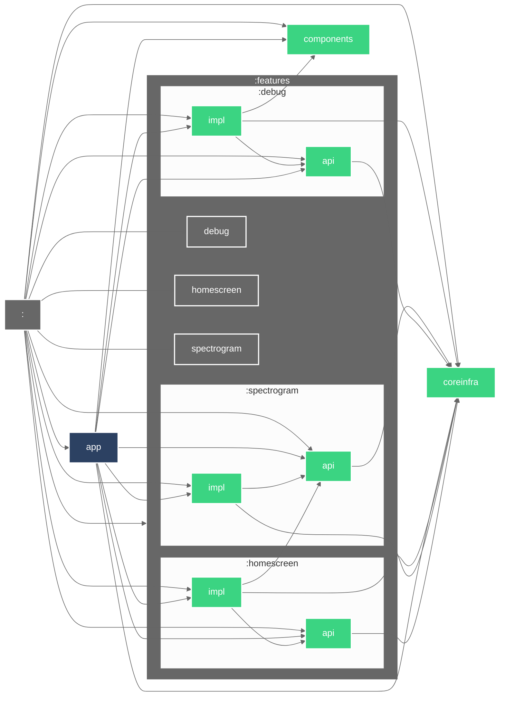

# Navigation

- Screen — A detailed set of information for the application to show. Contains all metadata required to display.
- Route — A specific name of a Screen available to the public API.
- Tab — The top level Composable displayed by a given Screen

# Module Graph

